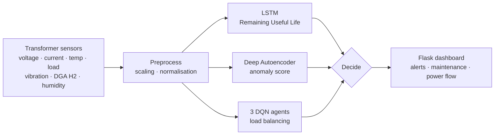

<div align="center">

# ⚡ Hybrid AI for Transformer Power Systems

**Multi-Agent Reinforcement Learning + Deep Anomaly Detection + LSTM Remaining-Useful-Life prediction**

*Research code for the paper "Hybrid AI-Driven Optimization for Transformer Power Systems: Multi-Agent Reinforcement Learning and Anomaly Detection". A patent has been filed on this work.*


</div>

---

## 🎯 Results

| Metric | Result |
|---|---|
| Fault / anomaly detection accuracy (autoencoder) | **97.5%** |
| Power-loss reduction (multi-agent DQN load balancing) | **18.6%** |
| Failure-rate reduction | **22.4%** |

Compared with earlier approaches (from the paper):

| Approach | Power-loss ↓ | Failure-rate ↓ |
|---|---|---|
| Rule-based (2021) | 4.5% | 6.2% |
| SVM-based anomaly detection (2022) | 10.2% | 12.4% |
| Single-agent RL (2023) | 14.6% | 17.3% |
| **This work (2025)** | **18.6%** | **22.4%** |

## 🧠 How it works



1. **Predictive maintenance:** an LSTM learns from past transformer behaviour and estimates Remaining Useful Life (RUL). If RUL drops below a critical limit, maintenance is recommended.
2. **Fault detection:** a deep autoencoder learns normal operation; a high reconstruction error means an abnormal condition, and a fault alert is raised.
3. **Load optimisation:** three Deep Q-Network agents (Multi-Agent RL) learn a policy for distributing power that minimises losses and failure risk.
4. **Dashboard:** a Flask API turns the three model outputs into actions.

Dataset: *AI Transformer Monitoring* (Kaggle), five CSVs covering sensor, load, failure, maintenance and weather data.

## 📁 Repository

| File | What it is |
|---|---|
| `predictive_maintenance_model.h5` | LSTM RUL model (input 10 × 10) |
| `autoencoder_fault_detection.h5` | Autoencoder for anomaly scoring (10 features) |
| `multi_agent_dqn_agent_{0,1,2}.h5` | The three DQN load-balancing agents (voltage, load, frequency) |
| `server.py` | Flask server: `/` and `POST /predict` |

## 🚀 Run it

```bash
pip install flask tensorflow numpy
# server.py loads models from absolute Windows paths, so point them to this folder first
python server.py
```

Then send a reading:

```bash
curl -X POST http://127.0.0.1:5000/predict -H "Content-Type: application/json" -d '{
  "voltage": 230, "current": 12, "PFL1": 0.92, "temperature": 65, "Load": 70,
  "humidity": 40, "vibration": 0.3, "DGA_H2": 120, "frequency": 50, "transformer_age": 8
}'
```

The response contains the predicted RUL, the anomaly score and the agents' load-balancing actions.

## 👥 Authors

Aneri Shah, **Krish Modi**, Ansh Soni, Nishant Doshi
Department of Computer Science & Engineering, School of Technology, Pandit Deendayal Energy University

<div align="center"><sub>Related work: <a href="https://github.com/krishmodi0202/NASA-Turbofan-Engine">NASA Turbofan predictive maintenance</a></sub></div>
